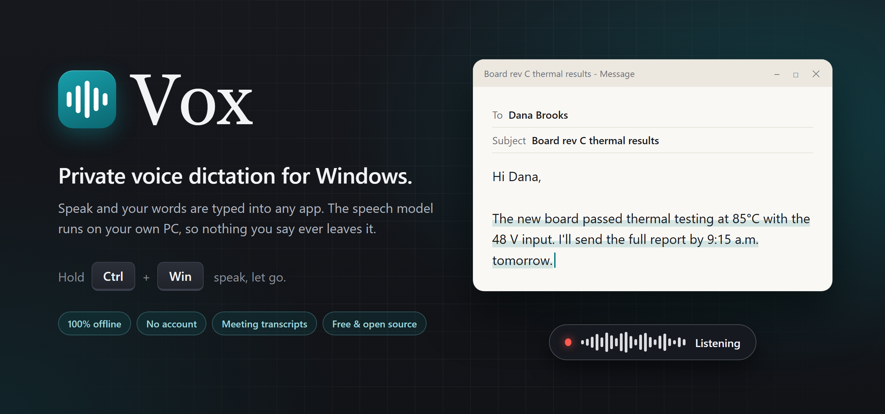
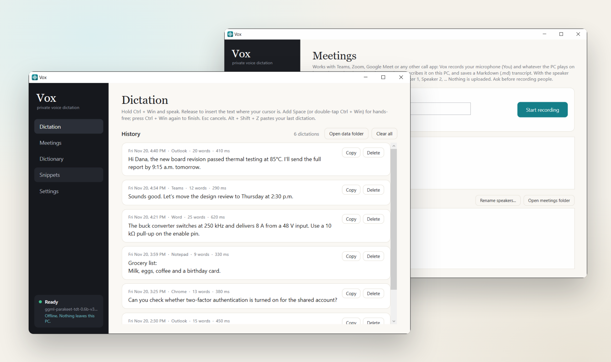
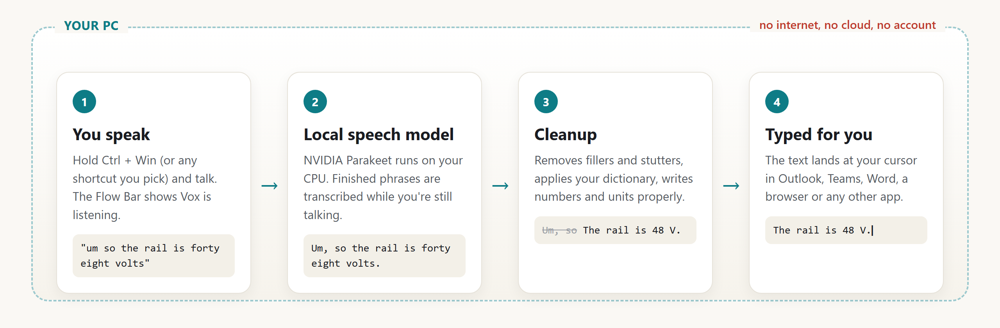
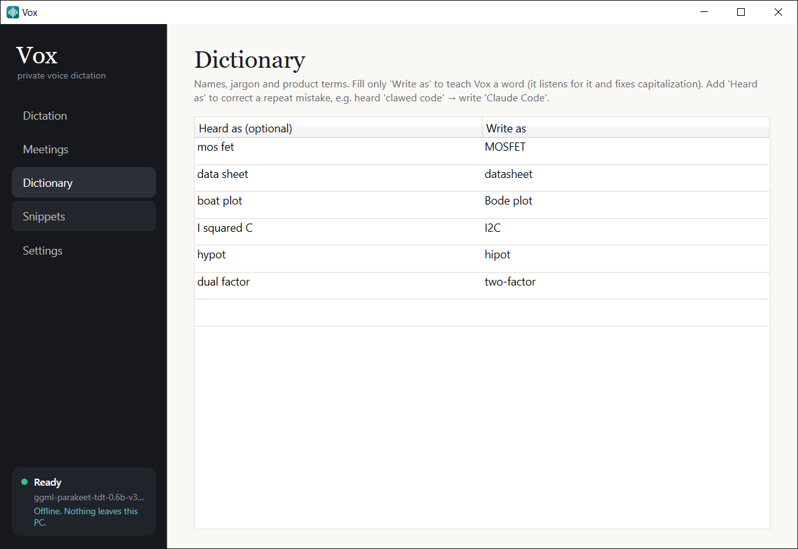
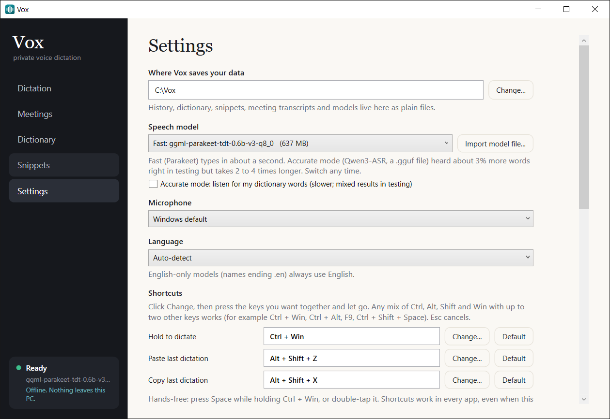
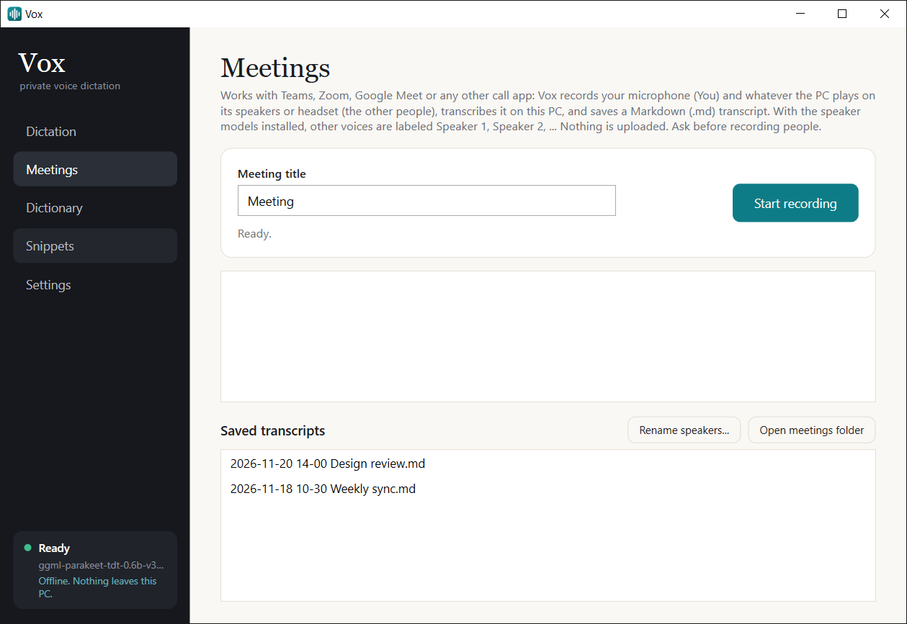

<p align="center">
  
</p>

<p align="center">
  <a href="https://github.com/mikeallette/vox/releases/latest"></a>
  
  
  <a href="LICENSE"></a>
</p>

<p align="center">
  <b>Hold a shortcut, talk, let go, and your words are typed into whatever app has the cursor.</b><br>
  The speech model runs on your own PC. No account, no cloud, no telemetry, and nothing you say ever leaves the computer.
</p>

<p align="center">
  <a href="#download">Download</a> ·
  <a href="#how-it-works">How it works</a> ·
  <a href="#features">Features</a> ·
  <a href="#meetings">Meetings</a> ·
  <a href="#privacy">Privacy</a> ·
  <a href="#building-from-source">Build</a>
</p>

<br>

<p align="center">
  
</p>

## Download

1. Open the [**latest release**](https://github.com/mikeallette/vox/releases/latest).
2. Download **`Vox-Setup-1.0.0.exe`** and run it. It installs just for you, with no administrator rights needed.
3. Start Vox from the Start menu, pick a folder for your data, and hold **Ctrl + Win** to talk.

| File | What it is |
|---|---|
| `Vox-Setup-<version>.exe` | **Installer (recommended).** Includes the speech model and the meeting speaker models, so it works right away. Adds a Start menu entry and an entry in Windows Settings > Apps for uninstalling. |
| `Vox-<version>-portable-win-x64.zip` | The same app as a folder. Unzip and run `app\Vox.exe`. Nothing is installed. |
| `Qwen3-ASR-1.7B-Q4_K_M.gguf` | Optional **Accurate mode** model (1.3 GB). Import it in Settings > Speech model. |
| `SHA256SUMS.txt` | Checksums for the files above. |

> [!NOTE]
> Vox isn't code-signed yet, so Windows SmartScreen may say *"Windows protected your PC"* the first time.
> Click **More info**, then **Run anyway**. To check a download, run `certutil -hashfile <file> SHA256`
> and compare the result with `SHA256SUMS.txt`.

**Requirements:** Windows 10 (version 1809 or later) or Windows 11, 64-bit, a recent Intel or AMD CPU,
about 1.5 GB of disk space, and roughly 2 GB of free memory. The .NET runtime is built in, so there's nothing else to install.

## How it works

<p align="center">
  
</p>

| Action | Default shortcut |
|---|---|
| Dictate | Hold **Ctrl + Win**, speak, let go |
| Hands-free | **Ctrl + Win + Space**, or double-tap Ctrl + Win. Press again to finish |
| Cancel | **Esc** |
| Paste the last dictation again | **Alt + Shift + Z** |
| Copy the last dictation | **Alt + Shift + X** |

Every shortcut can be changed in **Settings > Shortcuts**: click *Change...*, press the keys you want, and let go.
Any mix of Ctrl, Alt, Shift and Win works, with up to two other keys. A small **Flow Bar** at the bottom of the
screen shows when Vox is listening, and it follows the monitor you're working on.

## Features

<table>
<tr>
<td width="50%" valign="top">

**Dictation into any app**<br>
Outlook, Teams, Word, browsers, chat, code editors. Text is pasted at the cursor, with a typing fallback
for apps that block paste. If the app runs as administrator, Vox leaves the text on the clipboard and tells you.

**Quick results**<br>
Vox transcribes finished phrases while you're still talking, so there's little left to do when you let go.

**Clean text, not a raw transcript**<br>
Filler sounds (um, uh), stutters and false starts are removed. Say "new line" or "new paragraph" to format as you go.

</td>
<td width="50%" valign="top">

**Written like an engineer would**<br>
"forty eight volts" becomes **48 V**, "ten K pull up" becomes **10 kΩ pull up**, "eighty five degrees C"
becomes **85°C**, and "eight ten p m" becomes **8:10 p.m.** You can turn this off.

**Your words, spelled your way**<br>
The **Dictionary** teaches Vox names, part numbers and jargon, including words it keeps mishearing.
**Snippets** type a saved block of text when you say a short phrase.

**History you control**<br>
Every dictation can be saved locally with copy and delete, or not saved at all.

</td>
</tr>
</table>

<p align="center">
  
  
</p>

### Speech models

| Model | Size | Notes |
|---|---|---|
| **NVIDIA Parakeet TDT 0.6B v3** (included) | 640 MB | The default. Fast on an ordinary laptop CPU, about a second for a typical dictation. |
| **Qwen3-ASR 1.7B**, Accurate mode (optional download) | 1.3 GB | A few percent more words right in testing, but 2 to 4 times slower. English. |
| Whisper `ggml-*.bin` models (bring your own) | 40 MB and up | Supported for older or smaller PCs. |

You can switch models at any time in **Settings > Speech model**. Models are plain files in your data folder.

## Meetings

<p align="center">
  
</p>

Vox records your microphone (**You**) and everything your PC plays through its speakers or headset (the other
people), so it works with **Teams, Zoom, Google Meet** or any other call app, with no plugins or bots joining the call.
When you stop, it saves a timestamped Markdown transcript:

```markdown
**[00:00:04] You:** Okay, let's start with the thermal results from Tuesday.
**[00:00:11] Speaker 1:** The board held 85°C at full load. The hottest part was the inductor.
**[00:00:23] Speaker 2:** Did we change the copper weight on layer two?
```

Other voices are told apart and labeled Speaker 1, Speaker 2..., all on your PC, using the speaker models
included in the installer. **Rename speakers...** replaces the labels with real names. Please ask people
before you record them.

## Privacy

- Vox makes **no network connections**. It never downloads anything by itself and has no telemetry or account.
- Recordings, transcripts, history and your dictionary are plain files in **one folder you choose**.
  Uninstalling never deletes that folder.
- On first start, Vox suggests a data folder that isn't synced to OneDrive.
- Settings are in `%APPDATA%\Vox\settings.json`, and the log is in `%APPDATA%\Vox\vox.log`.

## Building from source

You need Windows 10 or 11 (x64), the [.NET 8 SDK](https://dotnet.microsoft.com/download/dotnet/8.0) and
[Inno Setup 7](https://jrsoftware.org/isinfo.php).

```powershell
dotnet build src\Vox\Vox.csproj -c Debug        # quick build to run from bin\Debug
.\build-release.ps1                              # installer, portable zip and checksums in dist\release
```

`build-release.ps1` expects the models in `models\`. The comment at the top of the script lists the exact files
and where to get them. The native engine DLLs are in `vendor\`, and each folder there has a `SOURCES.txt` with
the download source and SHA-256 hashes.

Some test commands are built into the app:

```powershell
Vox.exe --rule-tests out.txt tests\rules.tsv     # text cleanup rules (255 cases)
Vox.exe --hotkey-test out.txt                    # simulated keyboard, 45 checks
Vox.exe --selftest input.wav out.txt             # transcribe a 16 kHz WAV and show the cleanup
```

The README images are made from `docs\design\*.html`. Screenshots come from a demo copy of the app with made-up content.

## License

Vox is [MIT licensed](LICENSE). The engines and models it ships keep their own licenses (MIT, Apache-2.0
and CC BY 4.0). Details are in [THIRD-PARTY-NOTICES.md](THIRD-PARTY-NOTICES.md).

Vox is an independent project. It isn't affiliated with Wispr Flow, NVIDIA or Alibaba Qwen.
